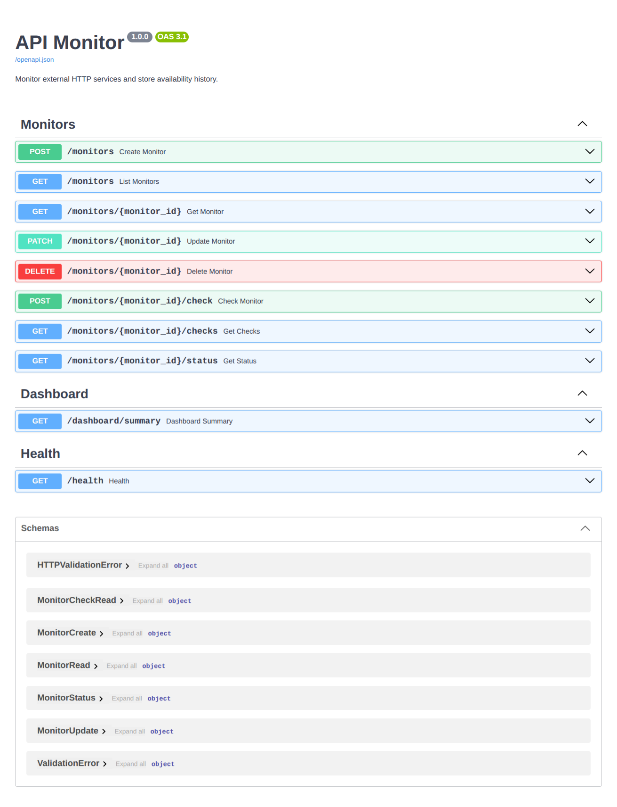

 <div align="center">

# API Monitor

### A REST API for Monitoring External HTTP Services

Monitor external endpoints, measure response times, track availability, and maintain historical check records.

[](https://www.python.org/)
[](https://fastapi.tiangolo.com/)
[](https://www.postgresql.org/)
[](https://www.sqlalchemy.org/)
[](https://www.docker.com/)

<br />

[About](#about-the-project) •
[Features](#key-features) •
[Technologies](#technology-stack) •
[Preview](#preview) •
[Installation](#getting-started) •
[API](#api-endpoints)

</div>


---

## 📸 Preview

<div align="center">

### Dashboard Preview



</div>

> **Live Demo:** [https://]
> **Repository:** [https://github.com/JeanRibeiro8/api-monitor]

---

## About the Project

API Monitor is a backend project designed to monitor external HTTP services through a RESTful API.

It allows users to register and manage monitored endpoints, manually execute availability checks, measure response times, and store historical results.

Each check records relevant information, including HTTP status codes when available, response time, availability status, error details, and execution timestamp.

The project was developed to explore backend development concepts such as REST API design, database integration, HTTP communication, automated testing, containerization, and CI workflows.

## Key Features

### Monitor Management
- Create, retrieve, update, and delete monitors.
- List registered endpoints.
- Configure monitor information and check intervals.
- Enable or disable individual monitors.

### HTTP Monitoring
- Execute manual HTTP availability checks.
- Measure request response times.
- Capture HTTP status codes.
- Distinguish HTTP error responses from connection failures.
- Configure request timeouts.
- Store individual check results.

### Monitoring History
- Retrieve historical check records.
- Access the latest monitoring status.
- Track availability and response information over time.

### API Overview
- Dashboard summary with monitoring counters.
- Health endpoint for API and database status.

### Infrastructure and Quality
- PostgreSQL persistence.
- SQLAlchemy 2.0 database integration.
- Alembic database migrations.
- Docker Compose environment.
- Automated tests with pytest.
- GitHub Actions CI workflow.

## Technology Stack

| Category | Technologies |
|---|---|
| Language | Python 3.12+ |
| API Framework | FastAPI |
| Data Validation | Pydantic |
| HTTP Client | HTTPX |
| ORM | SQLAlchemy 2.0 |
| Database | PostgreSQL |
| Migrations | Alembic |
| Testing | pytest, FastAPI TestClient |
| Containerization | Docker, Docker Compose |
| CI | GitHub Actions |

## Preview

The application interface preview is displayed below.

<div align="center">
  
  <p><em>API Monitor — Application Preview</em></p>
</div>

## Architecture

The application follows a layered structure that separates HTTP routes, data validation, business logic, and database access.

```text
api-monitor/
│
├── app/
│   ├── api/
│   │   └── routes/          # API endpoints
│   │
│   ├── core/                # Application settings
│   │
│   ├── db/
│   │   └── models/          # SQLAlchemy models
│   │
│   ├── repositories/        # Database access
│   │
│   ├── schemas/             # Pydantic schemas
│   │
│   └── services/            # Business logic and HTTP checks
│
├── migrations/              # Alembic migrations
├── tests/                   # Automated tests
├── public/                  # Project preview assets
├── .github/
│   └── workflows/           # CI pipeline
│
├── Dockerfile
├── docker-compose.yml
├── alembic.ini
├── requirements.txt
└── .env.example
```

## Getting Started

### Prerequisites

Make sure you have the following installed:

- Python 3.12+
- PostgreSQL (if running without Docker)
- Docker and Docker Compose (recommended)

### Installation with Docker

**1. Clone the repository**

```bash
git clone https://github.com/JeanRibeiro8/api-monitor.git
cd api-monitor
```

**2. Configure environment variables**

```bash
cp .env.example .env
```

Review the `.env` file and configure the required database settings.

**3. Start the application**

```bash
docker compose up --build
```

The API container runs database migrations before starting the application.

**4. Access the API documentation**

Open the interactive Swagger documentation:

```text
http://localhost:8000/docs
```

### Local Development

**1. Create and activate a virtual environment**

```bash
python3.12 -m venv .venv
source .venv/bin/activate
```

**2. Install dependencies**

```bash
pip install -r requirements.txt
```

**3. Configure environment variables**

```bash
cp .env.example .env
```

Configure `DATABASE_URL` to point to your local PostgreSQL database. When using local PostgreSQL, use `localhost` instead of the Docker database hostname.

**4. Run database migrations**

```bash
alembic upgrade head
```

**5. Start the development server**

```bash
uvicorn app.main:app --reload
```

The API will be available at:

```text
http://localhost:8000
```

Interactive documentation:

```text
http://localhost:8000/docs
```

## API Endpoints

| Method | Endpoint | Description |
|---|---|---|
| POST | `/monitors` | Create a monitor |
| GET | `/monitors` | List all monitors |
| GET | `/monitors/{id}` | Retrieve a monitor |
| PATCH | `/monitors/{id}` | Update a monitor |
| DELETE | `/monitors/{id}` | Delete a monitor |
| POST | `/monitors/{id}/check` | Execute a manual check |
| GET | `/monitors/{id}/checks` | Retrieve check history |
| GET | `/monitors/{id}/status` | Retrieve latest status |
| GET | `/dashboard/summary` | Retrieve dashboard counters |
| GET | `/health` | Check API and database health |

## Example Request

Create a new monitor:

```bash
curl -X POST http://localhost:8000/monitors \
  -H "Content-Type: application/json" \
  -d '{
    "name": "Example Website",
    "url": "https://example.com",
    "check_interval": 300
  }'
```

## Testing

Run the automated test suite with:

```bash
pytest -v
```

The tests use an isolated in-memory SQLite database and mock external HTTP behavior. They do not require real external services.

## Security Considerations and Limitations

- URL validation rejects localhost and non-public IP destinations after DNS resolution.
- Redirects are disabled during checks to avoid following unvalidated destinations.
- Response reading is bounded to reduce unnecessary data transfer.
- The current SSRF protections provide a baseline defense, not a complete production-grade security boundary.
- Automatic background scheduling is not implemented yet. The configured `check_interval` is currently stored for future scheduling functionality.
- The dashboard summary currently provides basic monitoring counters.

## Future Improvements

- Implement automatic background monitoring and scheduled checks.
- Improve outbound request security with DNS pinning and egress restrictions.
- Add rolling uptime and latency statistics.
- Introduce authentication and authorization.
- Implement rate limiting and operational metrics.
- Add integration tests against PostgreSQL.

---

<div align="center">

## Author

**Jean Ribeiro**

Backend Python Developer | Junior

[](https://github.com/JeanRibeiro8)
[](https://www.linkedin.com/in/jean-ribeiro-9a3792267/)
[](https://jeanribeiro8.github.io/JeanRibeiro/)
[](mailto:jeanrsantos10@gmail.com)

<br />
</div>